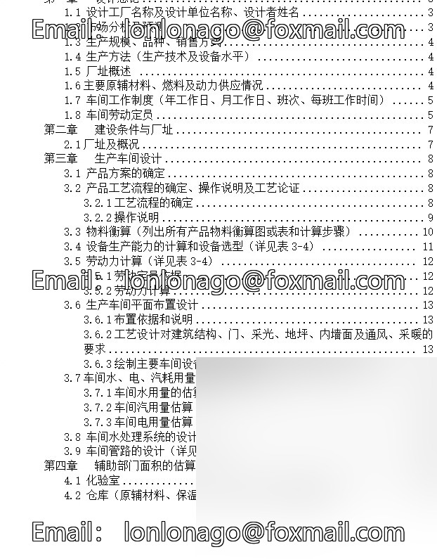
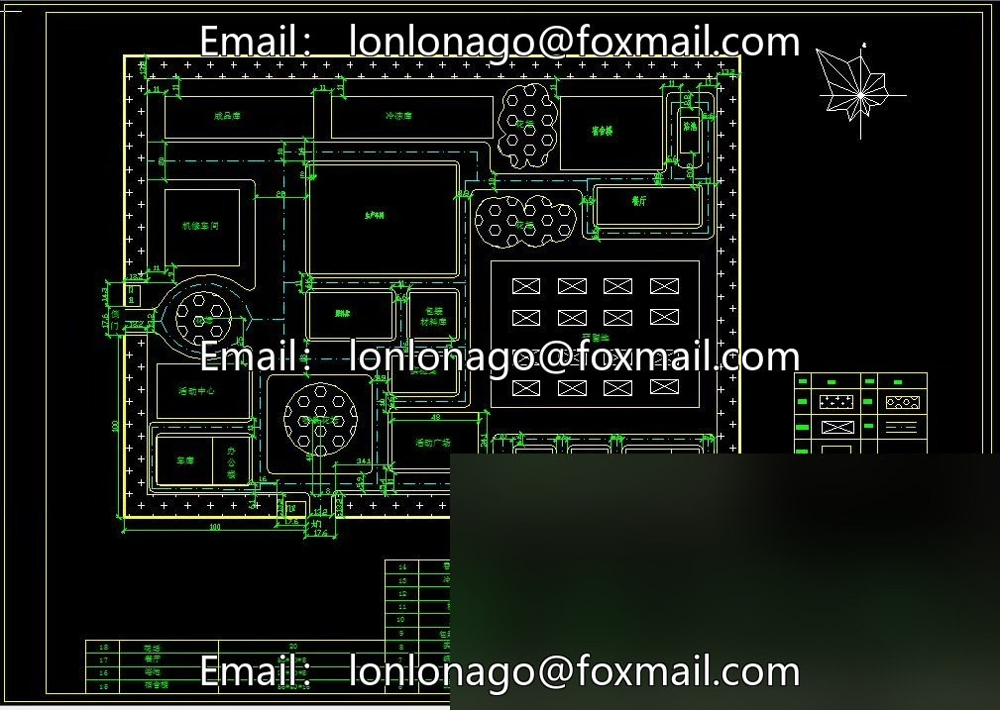
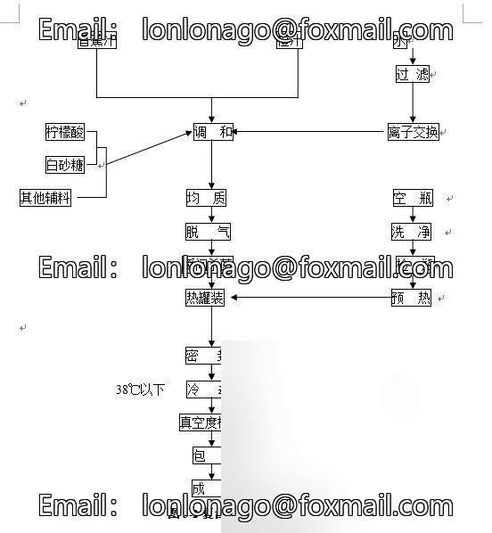
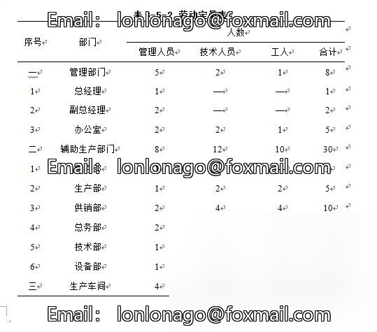
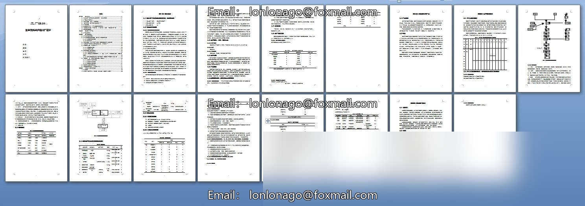

# Annual production of 130,000 tons of beverage production factory design; beverage production factory design diagram; beverage production factory design

## Body

Production capacity of 130,000 tons of beverage production factory design; beverage production factory design diagram; beverage production factory design CAD diagram

The design provides details on a 130,000-ton/year beverage production plant, covering design names and units, market analysis, production scale, processes, equipment selection, layout and related construction conditions.

<!-- AI_ENRICHED -->

## Images

## Payment

Here is a pay link on Stripe ( https://buy.stripe.com/3cs8yP7sY87d0vu9AB ). Please contact me lonlonago@foxmail.com after funding $89, and I will send you a complete data files , thank you!

